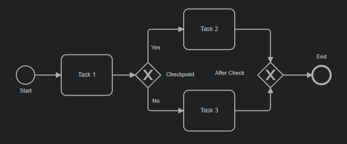

# BPMN Overview (Camunda Academy)

Course link: https://academy.camunda.com/bpmn-overview/

- [BPMN Overview (Camunda Academy)](#bpmn-overview-camunda-academy)
  - [Introduction](#introduction)
    - [Introduction to BPMN](#introduction-to-bpmn)
    - [Main BPMN Elements](#main-bpmn-elements)
  - [Gateways](#gateways)
  - [Course Completion](#course-completion)
  - [Additional Information](#additional-information)

## Introduction

### Introduction to BPMN

BPMN maps out your business processes in a **standardized**, **clear**, and **visual** format.

- BPMN is an open standard notation (https://www.omg.org/spec/BPMN) helping you to model your business processes in a clear, visual format.
- BPMN includes a set of symbols (https://camunda.com/bpmn/reference/) for modeling both complex and simple process workflows.

Below are the basic BPMN Symbols representations:
- Start Event: This shows what causes the process to start. This happens regardless of th process.
- Task: This is a step in the process. Task describe what needs to be done.
- Sequence Flow: This connects flow elements in a process. It makes the direction for the process flow.
- Gateway: This is a decision point that can adjust the path of a flow based on certain conditions.
- End Event: This represents the end of the process. You can have one or more end events in a process.

BPMN helps bridge the gap in communication between business, IT teams, and anyone else involved in process modeling in the organization.

BPMN diagrams are represented in XML which allows process engines to execute them, so that developers can easily implement and deploy processes. See source from the [samplebpmn.bpmn](./samplebpmn.bpmn) which illustrating as below:

BPMN is maintained by The Object Management Group (https://www.omg.org/), it is a core tool in **Business Process Management -- or BPM --** which is all about optimizing how work gets done and helping a business run smoother.

BPMN is **vendor-neutral**, **widely adopted**, and built for long-term success.

### Main BPMN Elements

BPMN classifies the graphical elements by categories so users can easily recognize them.

One category is represented by the **flow elements**: there are building blocks of any diagram and include events, tasks and gateways.

- Events: describes

## Gateways

## Course Completion

## Additional Information

---

Last updated at 2026-11-27