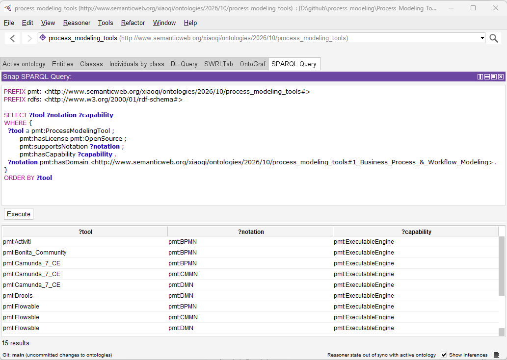

# Process Modeling Tools Ontology ([process_modeling_tools.rdf](./process_modeling_tools.rdf))

An open, living OWL/RDF knowledge graph that classifies and connects **Process Modeling Domains**, **Notations & Standards**, **Software Toolsets** (Commercial & Open-Source), **Execution Capabilities**, **Certifications**, and **Corporate Acquisitions**.

---

## 1. Purpose & Vision

Navigating the landscape of process modeling—spanning Business Process Management (BPM), Industrial Manufacturing (MES/VSM), Enterprise Architecture (EA), Process Mining, Discrete-Event Simulation, and Data/ML Orchestration—can be overwhelming. 

This ontology was created to:
1. **Provide a Clear "First-Glance" Landscape:** Offer architects, analysts, engineers, and researchers a structured bird's-eye view of available toolsets across diverse process modeling domains to support practical tool selection and next-step implementation.
2. **Bridge Standards and Implementations:** Explicitly map theoretical notations and industry standards (Level 2) to concrete software tools (Level 3) and their runtime execution capabilities.
3. **Share & Evolve with the Community:** Serve as a shared, machine-readable knowledge base that grows alongside a rapidly shifting software ecosystem.

---

## 2. Meta-Model Overview

The ontology follows a three-tier core hierarchy enriched with capability, licensing, certification, and market-evolution attributes:

```text
                                     ┌───────────────────┐
                                     │   Certification   │
                                     └─────────▲─────────┘
                                        │      │
                      appliesToNotation │      │ hasCertification
                                        ▼      │
┌────────────────────┐  hasDomain  ┌─────────────────────┐  supportsNotation  ┌─────────────────────────┐
│   ModelingDomain   │◄────────────│  NotationOrStandard │◄───────────────────│   ProcessModelingTool   │
│     (Level 1)      │             │      (Level 2)      │                    │        (Level 3)        │
└────────────────────┘             └─────────────────────┘                    └───┬─────────┬─────────┬─┘
                                                                                  │         │         │
                                                                    hasCapability │         │         │ isAcquiredBy
                                                                                  ▼         │         ▼
                                                                    ┌───────────────────┐   │   ┌───────────┐
                                                                    │ExecutionCapability│   │   │  (Self)   │
                                                                    └───────────────────┘   │   └───────────┘
                                                                                            │
                                                                                 hasLicense │
                                                                                            ▼
                                                                                  ┌───────────────────┐
                                                                                  │   LicenseModel    │
                                                                                  └───────────────────┘
```

*(Note: All six top-level classes are formally defined as `owl:AllDisjointClasses` to guarantee clean semantic separation during automated reasoning.)*

---

## 3. Class & Property Structure

### Classes (`owl:Class`)

| Class Name | Level / Role | Description |
| :--- | :--- | :--- |
| **`ModelingDomain`** | Level 1 | High-level functional paradigms grouping related modeling disciplines (6 domains). |
| **`NotationOrStandard`** | Level 2 | Formal modeling languages, graphical notations, or industry standards (e.g., BPMN, DMN, SysML, MES/MOM). |
| **`ProcessModelingTool`** | Level 3 | Concrete commercial or open-source software platforms, libraries, and engines (~60+ tools). |
| **`ExecutionCapability`** | Attribute | Defines what a tool actually *does* with a model (diagramming, execution, simulation, or mining). |
| **`LicenseModel`** | Attribute | Distinguishes licensing and distribution models (`Commercial` vs. `OpenSource`). |
| **`Certification`** | Governance | Industry standards conformance badges and vendor/platform certifications. |

### Object Properties (`owl:ObjectProperty`)

| Property | Domain (`rdfs:domain`) | Range (`rdfs:range`) | Semantics & Usage |
| :--- | :--- | :--- | :--- |
| **`hasDomain`** | `NotationOrStandard` | `ModelingDomain` | Categorizes a notation or standard under its primary functional domain. |
| **`supportsNotation`** | `ProcessModelingTool` | `NotationOrStandard` | Links a tool to one or more notations/standards it supports (many-to-many). |
| **`hasCapability`** | `ProcessModelingTool` | `ExecutionCapability` | Specifies runtime capabilities. Hybrid suites can hold multiple capabilities. |
| **`hasLicense`** | `ProcessModelingTool` | `LicenseModel` | Classifies the tool as `Commercial` or `OpenSource`. |
| **`hasCertification`** | `ProcessModelingTool` | `Certification` | Links a tool to official platform or standard-conformance certifications. |
| **`appliesToNotation`** | `Certification` | `NotationOrStandard` | Connects a certification or formal specification to the notation it governs. |
| **`isAcquiredBy`** | `ProcessModelingTool` | `ProcessModelingTool` | Tracks mergers, acquisitions, and rebrandings across the tool landscape. |

---

## 4. Key Instances & Relationships

### Level 1: Modeling Domains (`ModelingDomain`)
1. **`1_Business_Process_&_Workflow_Modeling`** — Human-centric, system-to-system, and operational workflows (`BPMN`, `CMMN`, `DMN`, `EPC`, `BPEL/XPDL`).
2. **`2_Industrial_&_Manufacturing_&_Shop-Floor_Operations`** — Physical production, shop-floor execution, and lean value streams (`MES/MOM`, `VSM`, `IDEF`).
3. **`3._Enterprise_Architecture_&_Systems_Engineering`** — Aligning business processes with IT and cyber-physical systems (`ArchiMate`, `UML`, `SysML`).
4. **`4_Process_Mining_&_Automated_Discovery`** — Reconstructing "as-is" process models from event logs (`Petri_Nets_/_Alpha_&_Inductive_Miners`).
5. **`5_Simulation_&_Discrete-Event_&_Quantitative_Modeling`** — Stochastic modeling, queueing theory, and feedback loops (`DES`, `System_Dynamics`).
6. **`6_Data_&_Integration_&_Scientific/ML_Pipelines`** — Data transformation workflows and computational execution graphs (`DAGs`, `DFD`).

### Execution Capabilities (`ExecutionCapability`)
* **`DiagrammingOnly`**: Visual modeling for documentation and analysis without native runtime execution (e.g., `Diagrams.net`, `Microsoft_Visio`, `Lucidchart`, `Archi`).
* **`ExecutableEngine`**: Deploys, orchestrates, or evaluates processes/rules/pipelines in production (e.g., `Camunda_8`, `Flowable`, `Apache_Airflow`, `Siemens_Opcenter`).
* **`Simulation`**: Runs time-stepped, discrete-event, or system-dynamics experiments (e.g., `AnyLogic`, `Rockwell_Arena`, `SimPy`, `Insight_Maker`).
* **`ProcessMining`**: Ingests event logs for automated discovery and conformance checking (e.g., `Celonis`, `ProM`, `PM4Py`, `SAP_Signavio_Process_Intelligence`).

*(Hybrid enterprise platforms such as `SAP_Signavio`, `Software_AG_ARIS`, `Sparx_Enterprise_Architect`, `Trisotech`, `Modelio`, and `IBM_Business_Automation_Workflow` link to multiple capabilities simultaneously.)*

### Certifications (`Certification`)
* **Standard & Conformance Specifications:** `ISO_IEC_19510`, `OMG_BPMN_2_0`, `OMG_CMMN`, `OMG_DMN`, `BPMN_MIWG_Conformant`, `Open_Group_ArchiMate`, `ArchiMate_Tool_Certified`, `ISA_95`, `ISA_88`, `ISO_27001_SOC2`.
* **Platform & Vendor Certifications:** `Camunda_Certified`, `Appian_Certified`, `Pega_Certified`, `Celonis_Certified`.

---

## 5. How to Use This Ontology

This RDF/OWL file (`process_modeling_tools.rdf`) is designed for dual-mode usage:

### Mode A: Structured Reference Dictionary & Catalog
Use the ontology as a canonical taxonomy and lookup directory:
* **Visual Exploration:** Open `process_modeling_tools.rdf` in **Protégé** (with OntoGraf or OWLViz) or **WebVOWL** to visually browse domains, standards, and tool clusters.
* **Tool Shortlisting:** Filter tools by license (`OpenSource` vs. `Commercial`), notation support (`BPMN` + `DMN`), or execution maturity (`DiagrammingOnly` vs. `ExecutableEngine`).
* **Documentation & Integration:** Import IRIs into enterprise architecture repositories or internal tech radars to standardize terminology.

### Mode B: Dynamic Semantic Reasoning & SPARQL Querying
Load the ontology into a triple store (e.g., **Apache Jena**, **GraphDB**, **Blazegraph**) or Python (`rdflib` / `owlready2`) with an OWL reasoner (**HermiT**, **Pellet**) to infer multi-hop relationships:
* **Cross-Domain Tool Discovery:** Find all open-source tools capable of executing workflows in Domain 1 (`ProcessModelingTool` $\rightarrow$ `supportsNotation` $\rightarrow$ `hasDomain`).
* **Hybrid Capability Inference:** Identify platforms that bridge *both* `DiagrammingOnly` and `Simulation` for end-to-end process design and bottleneck testing.
* **Certification & Compliance Tracing:** Traverse `ProcessModelingTool` $\rightarrow$ `hasCertification` $\rightarrow$ `appliesToNotation` to verify standard conformance.
* **M&A Lineage Tracking:** Query `isAcquiredBy` paths to trace legacy tools to their acquiring platforms.

#### Example SPARQL Query
```sparql
PREFIX pmt: <http://www.semanticweb.org/xiaoqi/ontologies/2026/10/process_modeling_tools#>
PREFIX rdfs: <http://www.w3.org/2000/01/rdf-schema#>

SELECT ?tool ?notation ?capability
WHERE {
  ?tool a pmt:ProcessModelingTool ;
        pmt:hasLicense pmt:OpenSource ;
        pmt:supportsNotation ?notation ;
        pmt:hasCapability ?capability .
  ?notation pmt:hasDomain <http://www.semanticweb.org/xiaoqi/ontologies/2026/10/process_modeling_tools#1_Business_Process_&_Workflow_Modeling> .
}
ORDER BY ?tool
```

You may see below result in table format:



---

## 6. A Living Ontology: Market Evolution & Community Contributions

The process modeling software market is constantly evolving—new open-source engines emerge, standards mature, and vendors frequently merge or acquire one another. 

We actively track corporate consolidation directly inside the graph using the **`isAcquiredBy`** object property and `rdfs:comment` annotations. Current examples captured in this ontology include:
* **`Dagster` $\xrightarrow{\text{isAcquiredBy}}$ `Prefect`** *(announced July 2026)*
* **`MEGA_HOPEX` $\xrightarrow{\text{isAcquiredBy}}$ `BiZZdesign_Horizzon`** *(merged into Bizzdesign Hopex Suite)*
* **`Libre` $\xrightarrow{\text{isAcquiredBy}}$ `Rhize`** *(rebranded/evolved into Rhize Manufacturing Data Hub)*
* **`Apromore_Community_Edition`** *(noted as acquired by Salesforce)*

### How You Can Contribute

Community members, practitioners, and tool maintainers are warmly invited to keep this knowledge graph accurate and up to date! Feel free to submit a Pull Request or Issue to contribute:
1. **New Tools & Standards:** Add emerging process modeling, orchestration, AI-agent workflow, or simulation tools along with their `supportsNotation`, `hasLicense`, and `hasCapability` triples.
2. **Missing Capability & Certification Links:** Enrich existing tool nodes that do not yet have `hasCapability` or `hasCertification` attributes populated.
3. **Acquisitions, Rebrandings & Retirements:** Add new `isAcquiredBy` links and dated `rdfs:comment` notes whenever vendors merge, rebrand, or sunset products.
4. **Metadata Enrichment:** Add official homepage URLs (`xsd:anyURI`) and concise descriptions via `rdfs:comment`.

*Base Ontology IRI:* `http://www.semanticweb.org/xiaoqi/ontologies/2026/10/process_modeling_tools`

---

Last updated at 2026-11-27