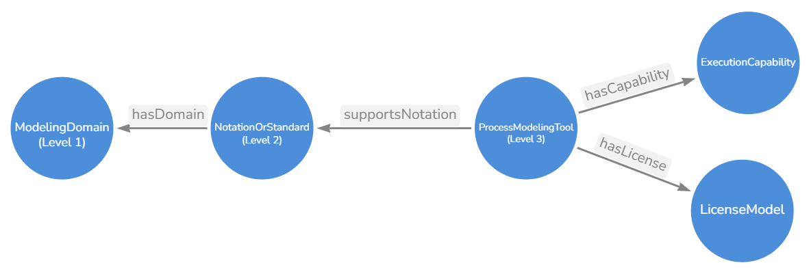

# Process Modeling

**Learn and practice BPMN, DMN, and other process modeling methodologies and tools.**

## Introduction

This repository is a learning and research workspace dedicated to **Process Modeling**, established as part of the ongoing exploration and development of the **EKA (Executable Knowledge Architecture)** framework.

The inspiration for this repository comes from the research conducted while writing the [Pizza OWL Ontology Practice](https://github.com/yasenstar/protege_pizza) book. During the exploration of ontology engineering and knowledge graph development, an important question emerged:

**How can we move from preparing structured knowledge to actually executing it?**

Ontology provides the foundation for representing concepts, relationships, constraints, and domain knowledge. However, to make enterprise knowledge truly executable, we also need to understand how business processes are modeled, how decisions are represented, and how operational activities are executed.

This leads to the next stage of exploration: the world of **BPMN, DMN, and MES**.

This repository is intended to support that journey and contribute to the knowledge foundation for **EKA Volume 5**.

## Research Scope

The initial focus is on three closely related areas:

### 1. BPMN — Business Process Model and Notation

Explore BPMN as a standardized approach to describing business processes, workflows, activities, events, gateways, and interactions.

The learning journey will start with building a BPMN knowledge base, collecting learning notes, documenting practical examples, and experimenting with different BPMN modeling tools and engines.

Key topics include:

- BPMN fundamentals and core modeling elements
- Process flows, events, gateways, and activities
- Pools, lanes, and collaboration
- Sub-processes and process orchestration
- BPMN execution engines and practical implementation
- Process modeling patterns and best practices

### 2. DMN — Decision Model and Notation

Explore DMN as a complementary approach to modeling business decisions and business rules.

While BPMN describes how work flows through a process, DMN helps explain how decisions are structured and evaluated within that process.

Key topics include:

- DMN fundamentals and decision requirements
- Decision Requirements Diagrams (DRD)
- Decision tables and business rules
- FEEL expressions
- Decision services
- Integration between BPMN processes and DMN decisions

### 3. MES — Manufacturing Execution Systems

Explore MES from the perspective of connecting business-level process models with operational execution.

This area will help extend the research beyond abstract process and decision models toward real-world enterprise operations.

Key topics will include:

- MES concepts and architecture
- Manufacturing processes and operational workflows
- Production execution and monitoring
- Integration between business processes and operational systems
- Connections between process models and enterprise knowledge

## Learning and Research Approach

The repository will evolve progressively through several stages:

1. **Build a BPMN Knowledge Base** — Start by collecting and organizing BPMN concepts, specifications, tutorials, references, and learning materials from different sources.

2. **Document Learning Notes** — Record structured notes, examples, modeling practices, tool experiments, and personal observations throughout the learning process.

3. **Explore DMN** — Extend the BPMN knowledge base with decision modeling concepts and investigate how business decisions can be explicitly represented.

4. **Combine BPMN and DMN** — Study how process models and decision models work together, particularly how decisions influence process execution and how business rules can be separated from process logic.

5. **Connect with MES and Operational Execution** — Investigate how process and decision models relate to operational systems and enterprise execution environments.

6. **Feed Knowledge Back into EKA** — Analyze how the accumulated knowledge can enrich the EKA framework, especially its ability to transform enterprise knowledge into executable intelligence.

## From Ontology to Execution: The EKA Connection

This repository represents an important extension of the EKA knowledge exploration journey.

The earlier ontology research, including the Pizza OWL practice, focuses on structuring knowledge through concepts, properties, relationships, restrictions, and reasoning.

Process and decision modeling introduce another dimension: **the behavior and execution of knowledge**.

The relationship can be understood at a high level:

| Knowledge Area | Primary Focus | Role in EKA |
|---|---|---|
| Ontology | Concepts and relationships | Knowledge representation |
| Knowledge Graph | Connected enterprise knowledge | Knowledge integration |
| BPMN | Business processes and workflows | Process representation and orchestration |
| DMN | Decisions and business rules | Decision representation and evaluation |
| MES | Operational execution | Connection to real-world operations |

The ultimate research question is how these different modeling disciplines can work together to support an executable enterprise knowledge architecture.

Rather than treating ontology, process modeling, decision modeling, and operational execution as isolated disciplines, EKA aims to explore their potential integration into a coherent knowledge architecture.

## Repository Structure

The repository structure will evolve as the research progresses. The initial organization is expected to include:

```text
Process_Modeling/
│
├── README.md
│
├── BPMN/
│   ├── KnowledgeBase/
│   ├── LearningNotes/
│   ├── Examples/
│   └── Tools/
│
├── DMN/
│   ├── KnowledgeBase/
│   ├── LearningNotes/
│   ├── Examples/
│   └── Tools/
│
├── MES/
│   ├── KnowledgeBase/
│   ├── LearningNotes/
│   └── Examples/
│
├── BPMN_DMN_Integration/
│
└── EKA_Integration/
```

## References and Related Projects

- **[EKA — Executable Knowledge Architecture](https://xiaoqi.com):** The overarching framework connecting enterprise architecture, meta-models, ontologies, knowledge graphs, and executable intelligence.
- **[Pizza OWL Ontology Practice](https://github.com/yasenstar/protege_pizza):** A practical exploration of ontology engineering using Protégé and OWL, which inspired this next stage of research.
- **[EKA Community](https://github.com/EKA-Community/eka):** The EKA framework, its concepts, publications, and related knowledge resources.

## Process Modeling Tools from Ontology View

Here is the meta-model that I'm gathering and classifying variable process modeling tools, check the RDF file for detail and welcome your contribution:



## The Journey Ahead

This repository is not intended to be just another collection of BPMN or DMN tutorials.

It is a continuous learning and research journey: starting with understanding process modeling, progressing toward decision modeling and operational execution, and ultimately investigating how these capabilities can contribute to the evolution of EKA.

**From Knowledge Representation to Process Execution. From Business Decisions to Executable Intelligence.**

Let's explore how enterprise knowledge can move beyond being modeled and documented — and become executable.

---

Last updated at 2026-11-27